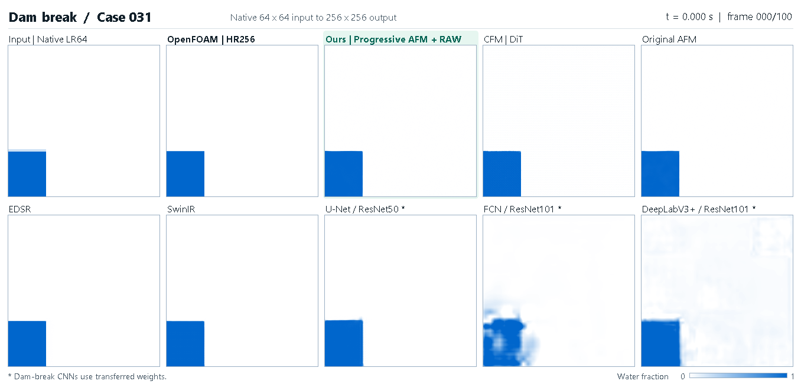
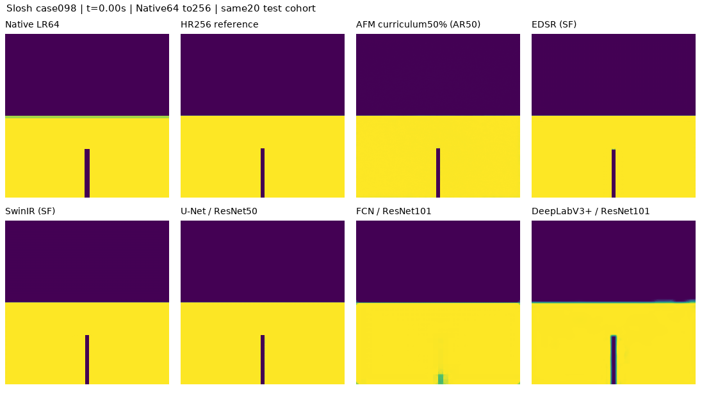
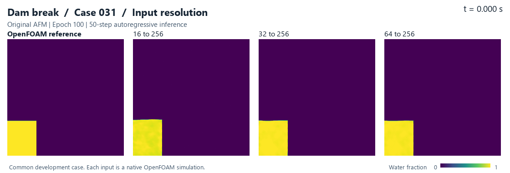
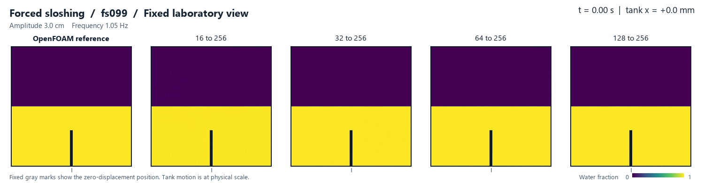

# FS-SR · Free-Surface Super-Resolution

We reconstruct the water volume fraction on a `256 × 256` grid from native `64 × 64` OpenFOAM simulations. The animations compare the coarse input, the fine-grid OpenFOAM reference, FS-SR, an adaptive flow-matching model with a progressive history schedule that reaches 50% and a regional change loss (RAW), and the baseline models at the same simulation time.

[Open the interactive demo](https://zhysess.github.io/FS-SR/) to pause, scrub, step through frames, and switch cases.

## Dam break

**Case 031** from the three shared development cases. CFM (DiT), original AFM, and our model use autoregressive inference with 50 flow integration steps per frame. EDSR, SwinIR, U-Net, FCN, and DeepLabV3+ use single-frame inference. The asterisks mark CNNs evaluated on these cases using historical checkpoints.

More cases · [010](docs/github_gif_showcase_20261104/assets/dam-break/case-010.gif) · [052](docs/github_gif_showcase_20261104/assets/dam-break/case-052.gif)

## Forced liquid sloshing

**Case 098** from the 20 held-out test cases. The eight panels show the coarse input, OpenFOAM reference, our model, EDSR, SwinIR, U-Net, FCN, and DeepLabV3+. Our model uses autoregressive inference with 50 flow integration steps per frame. The five single-frame baselines were trained on the same sloshing case split.

The camera is fixed in the laboratory frame. The tank, baffle, and water field translate together according to the prescribed horizontal motion for each case. Gray ticks mark the stationary center positions.

More cases · [006](docs/github_gif_showcase_20261104/assets/sloshing/case-006.gif) · [007](docs/github_gif_showcase_20261104/assets/sloshing/case-007.gif) · [009](docs/github_gif_showcase_20261104/assets/sloshing/case-009.gif)

## Dam break at three input resolutions

The original AFM baseline reconstructs the common development cases from native 16, 32, and 64 inputs, all at 256 output resolution. Each model uses its epoch-100 checkpoint and 50-step autoregressive inference.

More cases · [010](docs/github_gif_showcase_20261104/assets/dam-break-resolutions/case-010.gif) · [052](docs/github_gif_showcase_20261104/assets/dam-break-resolutions/case-052.gif)

## Sloshing at four input resolutions

The same held-out flow is reconstructed from native 16, 32, 64, and 128 grids. Each progressive AFM + RAW model reconstructs a 256-grid sequence using 50-step autoregressive inference. The runs share the case split. Training used batch size 4 for the 16 and 64 inputs and batch size 8 for the 32 and 128 inputs, resulting in different optimizer update counts.

More cases · [fs007](docs/github_gif_showcase_20261104/assets/sloshing-resolutions/fs007.gif) · [fs070](docs/github_gif_showcase_20261104/assets/sloshing-resolutions/fs070.gif)

Each animation contains 101 synchronized frames. Water fraction is shown on a fixed `[0, 1]` color scale with physical vertical direction pointing up. The dam-break and sloshing simulations use snapshot intervals of 0.015 s and 0.05 s, respectively.
